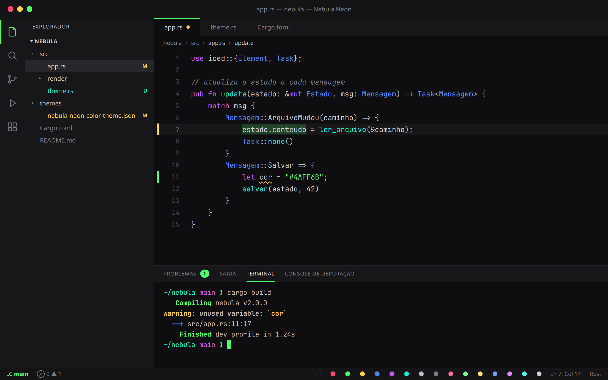
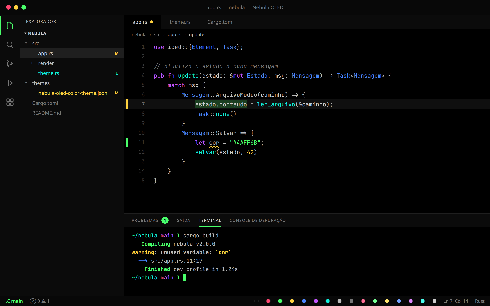
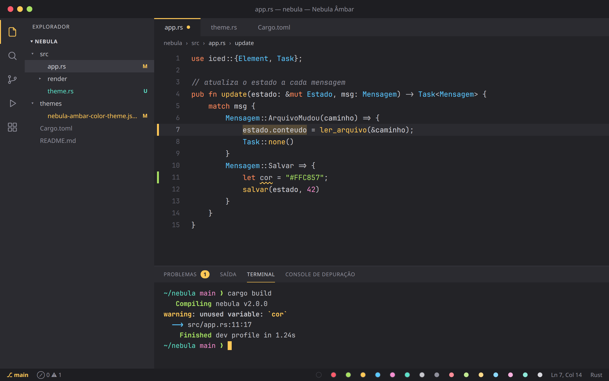
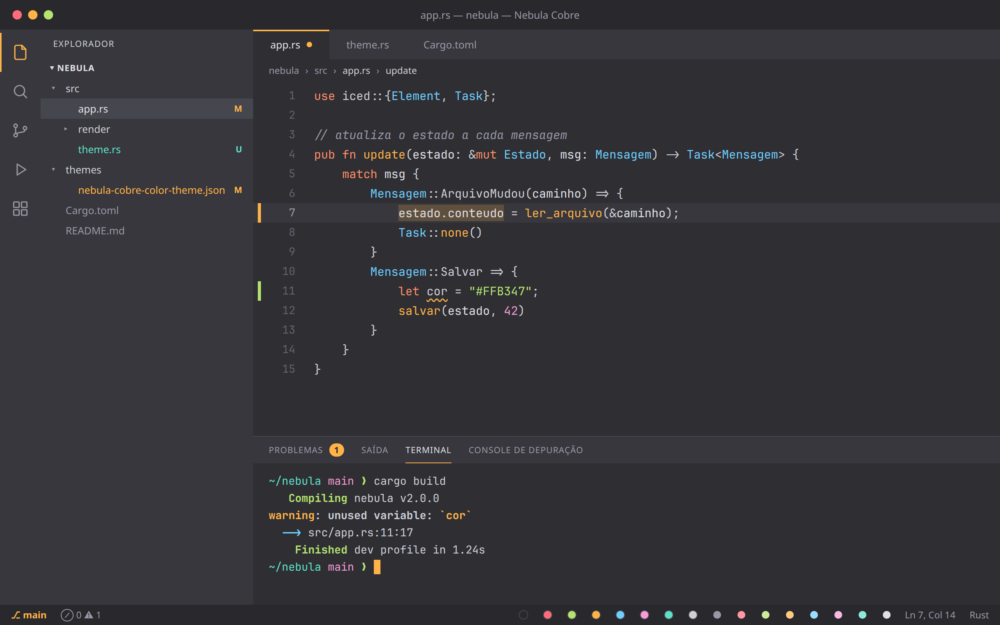
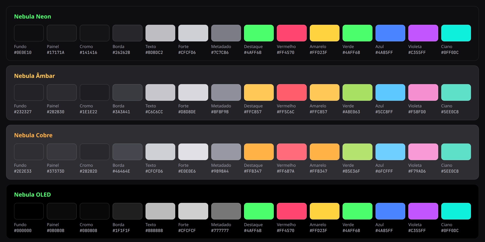

# Nebula Theme

Tema escuro para VS Code derivado de um menu do GRUB (tema *Space Isolation*)
e do esquema de cores irmão usado no Konsole — a ideia é uma identidade
visual só, do boot ao terminal ao editor.



*(mockup ilustrativo, gerado a partir das cores reais dos temas — não é um
screenshot do editor. Se você usa o tema, sinta-se à vontade para mandar um
screenshot de verdade num PR.)*

## Instalar

**Do Marketplace:** ainda não publicado lá — por enquanto, baixe o `.vsix`
da [página de releases](https://github.com/TheBud4/nebula-theme/releases)
e instale pelo CLI:

```bash
code --install-extension nebula-theme-2.0.0.vsix
```

⚠️ **Não copie a pasta do repo direto para `~/.vscode/extensions/`.** O VS
Code espera que uma extensão passe pelo fluxo de instalação oficial (que
registra ela em `extensions.json` com os metadados certos); uma pasta
colada à mão fica marcada como obsoleta pelo próprio VS Code a cada
abertura e some do seletor de temas em silêncio. Sempre `.vsix` +
`code --install-extension`.

Para empacotar seu próprio `.vsix` a partir do código-fonte:

```bash
git clone https://github.com/TheBud4/nebula-theme.git
cd nebula-theme
npx @vscode/vsce package
code --install-extension nebula-theme-*.vsix
```

Depois de instalar (por qualquer um dos dois jeitos), reabra o VS Code,
`Ctrl+Shift+P` → **Preferences: Color Theme** → um dos quatro temas (veja abaixo).

## Temas

Todos partem de fundos cinza quase neutros (sem o roxo das versões 1.x) e
usam um texto forte cinza-claro em vez de branco puro.

| Tema | Fundo | Destaque | Ideia |
|---|---|---|---|
| **Nebula Neon** | `#0E0E10` grafite | verde `#4AFF6B` | O Nebula original, em cinza neutro. Cores neon. |
| **Nebula Âmbar** | `#232327` cinza médio | âmbar `#FFC857` | Quente: âmbar, laranja, verde-limão, azul-céu. |
| **Nebula Cobre** | `#2E2E33` cinza claro | cobre `#FFB347` | Mesma ideia, fundo mais claro e cores um pouco mais vivas. |
| **Nebula OLED** | `#000000` preto | verde `#4AFF6B` | Neon sobre preto absoluto. |

<table>
<tr>
<td><br><sub><b>Neon</b></sub></td>
<td><br><sub><b>OLED</b></sub></td>
</tr>
<tr>
<td><br><sub><b>Âmbar</b></sub></td>
<td><br><sub><b>Cobre</b></sub></td>
</tr>
</table>

## Paletas



### Interface

| Papel | Neon | Âmbar | Cobre | OLED |
|---|---|---|---|---|
| Fundo do editor | `#0E0E10` | `#232327` | `#2E2E33` | `#000000` |
| Painéis / sidebar | `#17171A` | `#2B2B30` | `#37373D` | `#0B0B0B` |
| Cromo (title bar, status bar) | `#141416` | `#1E1E22` | `#28282D` | `#080808` |
| Borda | `#26262B` | `#3A3A41` | `#46464E` | `#1F1F1F` |
| Texto | `#BDBDC2` | `#C6C6CC` | `#CFCFD6` | `#BBBBBB` |
| Texto forte (parâmetros, aba ativa) | `#CFCFD6` | `#D8D8DE` | `#E0E0E6` | `#CFCFCF` |
| Metadado (comentários, breadcrumb) | `#7C7C86` | `#8F8F9B` | `#9898A4` | `#777777` |
| Inativo (números de linha) | `#3F3F46` | `#5A5A64` | `#63636D` | `#3A3A3A` |
| Destaque (cursor, aba ativa, git added) | `#4AFF6B` | `#FFC857` | `#FFB347` | `#4AFF6B` |

### Sintaxe

| Papel | Neon / OLED | Âmbar | Cobre |
|---|---|---|---|
| Keywords | `#C355FF` violeta | `#FF8A5B` laranja | `#FF8F66` laranja |
| Strings | `#4AFF6B` verde | `#A8E063` verde-limão | `#B5E36F` verde-limão |
| Funções | `#0FF0DC` ciano | `#FFC857` âmbar | `#FFB347` cobre |
| Números e constantes | `#FFD23F` amarelo | `#F58FD0` rosa | `#F79AD6` rosa |
| Tipos | `#4A85FF` azul | `#5CC8FF` azul-céu | `#6FCFFF` azul-céu |
| Erro, tags, decorators | `#FF4570` vermelho | `#FF5C6C` vermelho | `#FF6B7A` vermelho |

O terminal usa as 16 cores ANSI completas, derivadas dessas mesmas cores
(veja `terminal.ansi*` em cada arquivo de `themes/`).

136 chaves de cor cobertas (editor, sidebar, tabs, terminal com as 16 cores
ANSI completas, git decorations, botões, notificações, peek view, diff
editor, merge conflicts, scrollbar, gutter), 17 `tokenColors` e 18
`semanticTokenColors` — cobertura pensada pra não cair no azul padrão do
Dark+ em nenhum canto comum da UI.

A barra de título também segue o tema: com `"window.titleBarStyle": "custom"`
o próprio VS Code desenha a faixa de título usando `titleBar.activeBackground`,
em vez de deixar o compositor do sistema desenhar por fora, fora do tema.

## Por que existe

Nasceu de uma restauração de sistema (Fedora, pós-formatação) onde o
objetivo era ter a mesma identidade visual entre o menu de boot, o
terminal e o editor, em vez de três temas escolhidos sem relação entre
si. A versão 1.0/1.1 usava os valores exatos do tema do GRUB e do Konsole
(verde `#5AEB71`, texto `#ACA8A5`, fundo `#121019`). A 1.2 puxou contraste
e saturação para cima, pensando no editor — onde se olha por muito mais
tempo, num monitor tipicamente mais claro que uma tela de boot. A 2.0
tirou o roxo dos fundos (grafite neutro) e o branco puro, e acrescentou
três variações. Por isso os valores **não batem mais 1:1** com o
Konsole/GRUB; a ideia (hierarquia de camadas fundo → painel → cromo →
borda, e as mesmas famílias de cor) é a mesma.

## Contribuindo

As imagens de `docs/` são geradas a partir dos JSONs de `themes/`, não
desenhadas à mão. Depois de mexer em cores, regenere:

```bash
node scripts/gen-previews.mjs   # precisa de Google Chrome/Chromium
CHROME=chromium node scripts/gen-previews.mjs   # para usar outro navegador
```

E atualize as tabelas de paleta acima se algum valor mudou.

## Changelog

Ver [CHANGELOG.md](CHANGELOG.md).

## Licença

MIT — ver [LICENSE](LICENSE).
