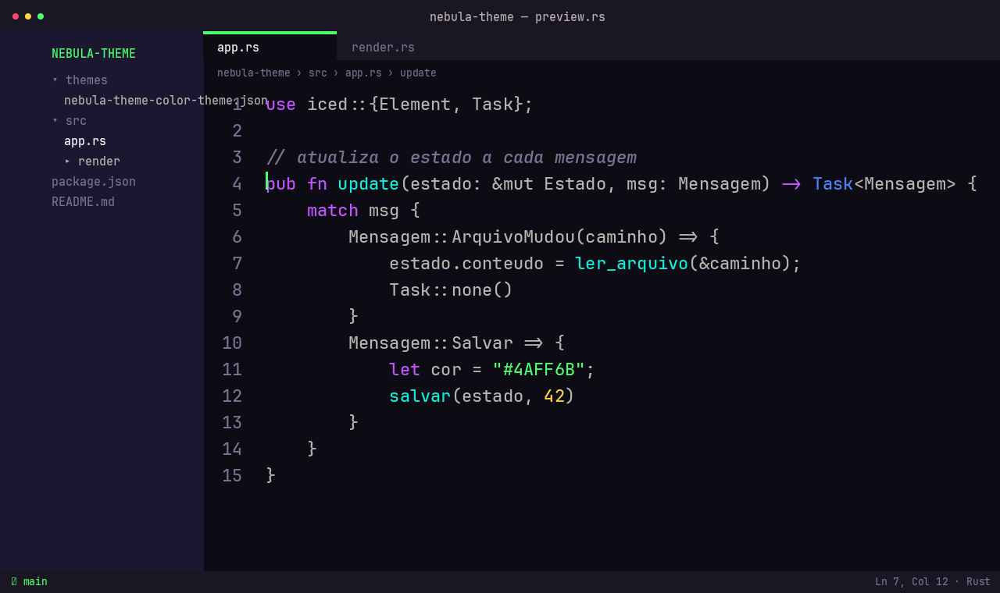

# Nebula Theme

Tema escuro para VS Code derivado de um menu do GRUB (tema *Space Isolation*)
e do esquema de cores irmão usado no Konsole — a ideia é uma identidade
visual só, do boot ao terminal ao editor.



*(mockup ilustrativo das cores, não é um screenshot real do editor — se você
usa o tema, sinta-se à vontade a mandar um screenshot de verdade num PR.)*

## Instalar

**Do Marketplace:** ainda não publicado lá — por enquanto, baixe o `.vsix`
da [página de releases](https://github.com/TheBud4/nebula-theme/releases)
e instale pelo CLI:

```bash
code --install-extension nebula-theme-2.0.0.vsix
```

⚠️ **Não copie a pasta do repo direto para `~/.vscode/extensions/`.** O VS
Code espera que uma extensão passe pelo fluxo de instalação oficial (que
registra ela em `extensions.json` com os metadados certos); uma pasta
colada à mão fica marcada como obsoleta pelo próprio VS Code a cada
abertura e some do seletor de temas em silêncio. Sempre `.vsix` +
`code --install-extension`.

Para empacotar seu próprio `.vsix` a partir do código-fonte:

```bash
git clone https://github.com/TheBud4/nebula-theme.git
cd nebula-theme
npx @vscode/vsce package
code --install-extension nebula-theme-*.vsix
```

Depois de instalar (por qualquer um dos dois jeitos), reabra o VS Code,
`Ctrl+Shift+P` → **Preferences: Color Theme** → um dos quatro temas (veja abaixo).

## Temas

Todos partem de um fundo cinza neutro (sem o roxo das versões 1.x) e usam
um texto forte cinza-claro em vez de branco puro.

| Tema | Fundo | Destaque | Ideia |
|---|---|---|---|
| **Nebula Neon** | `#0E0E10` grafite | verde `#4AFF6B` | O Nebula original, em cinza neutro. Cores neon. |
| **Nebula Âmbar** | `#232327` cinza médio | âmbar `#FFC857` | Quente: âmbar, laranja, verde-limão, azul-céu. |
| **Nebula Cobre** | `#2E2E33` cinza claro | cobre `#FFB347` | Mesma ideia, fundo mais claro e cores um pouco mais vivas. |
| **Nebula OLED** | `#000000` preto | verde `#4AFF6B` | Neon sobre preto absoluto. |

## Paleta (Nebula Neon)

| Papel | Cor |
|---|---|
| Fundo | `#0E0E10` |
| Painéis / sidebar | `#17171A` |
| Cromo (title bar, status bar) | `#141416` |
| Borda | `#26262B` |
| Texto | `#BDBDC2` |
| Texto forte | `#CFCFD6` |
| Metadado (line numbers, breadcrumb) | `#7C7C86` |
| Inativo | `#3F3F46` |
| Destaque (cursor, strings, git added) | `#4AFF6B` |
| Vermelho (erro, deletado) | `#FF4570` |
| Amarelo (aviso, números) | `#FFD23F` |
| Azul (tipos, info) | `#4A85FF` |
| Violeta (keywords) | `#C355FF` |
| Ciano (funções) | `#0FF0DC` |

136 chaves de cor cobertas (editor, sidebar, tabs, terminal com as 16 cores
ANSI completas, git decorations, botões, notificações, peek view, diff
editor, merge conflicts, scrollbar, gutter), 17 `tokenColors` e 18
`semanticTokenColors` — cobertura pensada pra não cair no azul padrão do
Dark+ em nenhum canto comum da UI.

A barra de título também segue o tema: com `"window.titleBarStyle": "custom"`
o próprio VS Code desenha a faixa de título usando `titleBar.activeBackground`,
em vez de deixar o compositor do sistema desenhar por fora, fora do tema.

## Por que existe

Nasceu de uma restauração de sistema (Fedora, pós-formatação) onde o
objetivo era ter a mesma identidade visual entre o menu de boot, o
terminal e o editor, em vez de três temas escolhidos sem relação entre
si. A versão 1.0/1.1 usava os valores exatos do tema do GRUB e do Konsole
(verde `#5AEB71`, texto `#ACA8A5`, fundo `#121019`). A partir da 1.2, o
Nebula Theme puxou o contraste e a saturação pra cima especificamente para
o editor — onde se olha por muito mais tempo, num monitor tipicamente mais
claro que uma tela de boot — então os valores **não batem mais 1:1** com o
Konsole/GRUB. A identidade (mesmos matizes, mesma hierarquia de camadas)
continua a mesma; os números mudaram.

## Changelog

Ver [CHANGELOG.md](CHANGELOG.md).

## Licença

MIT — ver [LICENSE](LICENSE).
